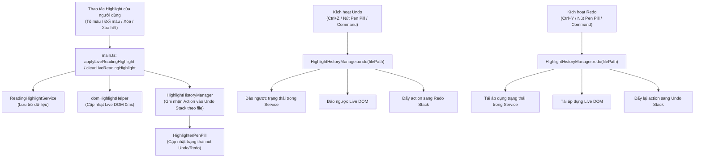

# Kế Hoạch Triển Khai: Tính Năng Hoàn Tác (Undo) & Làm Lại (Redo) Highlight

> **Mục tiêu**: Xây dựng hệ thống quản lý lịch sử (Undo/Redo Stack) chuyên dụng cho tính năng Highlight trong Reading Mode của Obsidian Polyglot Study Plugin, hỗ trợ đầy đủ qua Phím tắt (`Ctrl+Z`, `Ctrl+Y`), nút bấm trên thanh Bút dạ quang (`HighlighterPenPill`), và Obsidian Command Palette.  
> **Tiêu chuẩn kỹ thuật**: TDD (Test-Driven Development), 0ms live DOM mutation (không reload trang), 100% Obsidian CSS Theme Tokens, Native Lucide SVGs, Taste Skill v2 compliant.

---

## 1. Tổng Quan Kiến Trúc & Luồng Dữ Liệu



---

## 2. Thiết Kế Chi Tiết Các Thành Phần (Proposed Changes)

### Component 1: Module Quản Lý Lịch Sử (`HighlightHistoryManager`)
#### [NEW] `src/services/history/HighlightHistoryManager.ts`
- Định nghĩa kiểu dữ liệu hành động `HighlightHistoryAction`:
  ```typescript
  export type HighlightHistoryAction =
    | { type: "add"; filePath: string; item: ReadingHighlightItem }
    | { type: "remove"; filePath: string; items: ReadingHighlightItem[] }
    | { type: "update"; filePath: string; id: string; oldColor: HighlightColorKey; newColor: HighlightColorKey; text: string }
    | { type: "clear-all"; filePath: string; items: ReadingHighlightItem[] };
  ```
- Quản lý 2 ngăn xếp riêng biệt cho mỗi file ghi chú:
  ```typescript
  interface FileHistoryStacks {
    undoStack: HighlightHistoryAction[];
    redoStack: HighlightHistoryAction[];
  }
  ```
- Giới hạn độ sâu lịch sử: `MAX_HISTORY = 30` thao tác gần nhất/file (tự động loại bỏ thao tác cũ nhất khi vượt ngưỡng để đảm bảo hiệu năng RAM).
- API cốt lõi:
  - `recordAdd(filePath, item)`
  - `recordRemove(filePath, items)`
  - `recordUpdate(filePath, id, oldColor, newColor, text)`
  - `recordClearAll(filePath, items)`
  - `canUndo(filePath): boolean`
  - `canRedo(filePath): boolean`
  - `undo(filePath): HighlightHistoryAction | null`
  - `redo(filePath): HighlightHistoryAction | null`
  - `clear(filePath?: string): void`

---

### Component 2: Nâng Cấp `ReadingHighlightService` Để Hỗ Trợ Đầy Đủ Hoàn Tác
#### [MODIFY] [`src/services/storage/ReadingHighlightService.ts`](file:///D:/obsidian-polyglot-study/src/services/storage/ReadingHighlightService.ts)
- Bổ sung thông tin `oldColor` khi cập nhật màu từ trước:
  ```typescript
  export interface AddHighlightResult {
    action: "added" | "updated" | "removed";
    item?: ReadingHighlightItem;
    oldColor?: HighlightColorKey;
  }
  ```
- Bổ sung phương thức khôi phục chính xác danh sách highlight đã xóa (giữ nguyên ID và timestamp):
  ```typescript
  restoreHighlights(filePath: string, items: ReadingHighlightItem[]): void;
  ```

---

### Component 3: Điều Phối & Tích Hợp Vào `main.ts`
#### [MODIFY] [`main.ts`](file:///D:/obsidian-polyglot-study/main.ts)
1. **Khởi tạo & Quản lý**:
   - Khởi tạo instance `highlightHistory = new HighlightHistoryManager();`.
   - Lắng nghe sự kiện đổi tên/xóa file để đồng bộ path trong history stack.
2. **Ghi vết tự động (Record)**:
   - Trong `applyLiveReadingHighlight`: Ghi nhận `recordAdd`, `recordUpdate`, hoặc `recordRemove`.
   - Trong `clearLiveReadingHighlight`: Ghi nhận `recordRemove` kèm danh sách item đã gỡ.
   - Trong `clearAllReadingHighlights`: Ghi nhận `recordClearAll` kèm snapshot toàn bộ highlight trước khi xóa.
3. **Thực thi Hoàn tác & Làm lại (Undo/Redo Dispatcher)**:
   - `undoReadingHighlight(view?: MarkdownView): boolean`:
     - Trích xuất action từ `highlightHistory.undo(filePath)`.
     - Phục hồi service + Live DOM tương ứng (0ms, không nhấp nháy màn hình).
     - Cập nhật trạng thái nút bấm trên `penPill`.
     - Hiển thị Notice ngắn (`"Đã hoàn tác thao tác highlight"`).
   - `redoReadingHighlight(view?: MarkdownView): boolean`:
     - Trích xuất action từ `highlightHistory.redo(filePath)`.
     - Tái áp dụng service + Live DOM.
     - Cập nhật trạng thái nút bấm trên `penPill`.
     - Hiển thị Notice ngắn (`"Đã làm lại thao tác highlight"`).
4. **Bắt sự kiện Phím Tắt Toàn Cục**:
   - `registerDomEvent(document, "keydown", (e: KeyboardEvent) => ...)`:
     - Kiểm tra nếu chế độ xem đang là Reading Mode (`view.getMode() === "preview"`).
     - `Ctrl+Z` / `Cmd+Z` (không kèm `Shift`): gọi `undoReadingHighlight()`.
     - `Ctrl+Y` hoặc `Ctrl+Shift+Z` / `Cmd+Shift+Z`: gọi `redoReadingHighlight()`.
     - Chỉ gọi `e.preventDefault()` khi thao tác undo/redo thực sự có lịch sử và thành công (tránh chặn nhầm các phím tắt hệ thống khác).
5. **Đăng ký Commands**:
   - `polyglot-study:undo-highlight`: *"Hoàn tác highlight vừa tạo/xóa (Undo)"*
   - `polyglot-study:redo-highlight`: *"Làm lại thao tác highlight (Redo)"*

---

### Component 4: Nút Bấm Trực Quan Trên Thanh Bút Dạ Quang (`HighlighterPenPill`)
#### [MODIFY] [`src/ui/HighlighterPenPill.ts`](file:///D:/obsidian-polyglot-study/src/ui/HighlighterPenPill.ts)
- Bổ sung 2 callback: `onUndo?: () => void`, `onRedo?: () => void`.
- Bổ sung 2 nút vector icon chuẩn Lucide:
  - Nút Undo: `safeSetIcon(undoBtn, "undo-2", "Hoàn tác highlight (Ctrl+Z)")`.
  - Nút Redo: `safeSetIcon(redoBtn, "redo-2", "Làm lại highlight (Ctrl+Y)")`.
- Phương thức `setHistoryState(canUndo: boolean, canRedo: boolean): void`:
  - Thêm class `.is-disabled` khi ngăn xếp rỗng.
#### [MODIFY] [`styles.css`](file:///D:/obsidian-polyglot-study/styles.css)
- Bổ sung styling cho `.polyglot-pen-pill .pen-pill-history-btn`:
  - Kích thước vừa vặn, padding chuẩn giao diện pill.
  - Trạng thái `.is-disabled`: `opacity: 0.35; cursor: not-allowed; pointer-events: none;`.

---

## 3. Kế Hoạch Kiểm Thử TDD (Test-Driven Development)

### 3.1. Unit Tests
- `tests/services/HighlightHistoryManager.test.ts` (Mới):
  - Kiểm thử `recordAdd`, `undo`, `redo`.
  - Kiểm thử `recordRemove`, `undo`, `redo` với nhiều highlight cùng lúc.
  - Kiểm thử `recordUpdate` (đổi màu) hoàn về đúng màu cũ.
  - Kiểm thử `recordClearAll` khôi phục lại trọn vẹn danh sách highlight.
  - Kiểm thử giới hạn ngăn xếp `MAX_HISTORY = 30` (tự xoay vòng).
  - Kiểm thử thao tác mới xóa sạch Redo Stack.
  - Kiểm thử ngăn xếp độc lập giữa các file khác nhau.
- `tests/ui/HighlighterPenPillHistory.test.ts` (Mới):
  - Kiểm thử render nút Undo & Redo chuẩn vector SVG.
  - Kiểm thử gọi đúng callback khi click nút.
  - Kiểm thử cập nhật trạng thái disabled/enabled qua `setHistoryState`.
- `tests/mainUndoRedo.test.ts` (Mới hoặc bổ sung vào `tests/main.test.ts`):
  - Kiểm thử chu trình phím tắt `Ctrl+Z` và `Ctrl+Y` trong Reading Mode.
  - Kiểm thử không can thiệp vào Edit Mode.

### 3.2. Verification Commands
1. Chạy toàn bộ test suites:
   ```powershell
   npx vitest run
   ```
2. Chạy Taste Skill Static Linter:
   ```powershell
   node "C:\Users\VinhDat\.gemini\config\skills\taste-skill\scripts\lint.mjs"
   ```
3. Rebuild production bundle:
   ```powershell
   npm run build
   ```
4. Copy deploy sang Vault Obsidian thực tế và kiểm tra hoạt động.

---

## 4. Phân Đoạn Triển Khai (Execution Tasks)

| Task | Nội dung | File thực thi chính |
| :--- | :--- | :--- |
| **Task 1** | Xây dựng `HighlightHistoryManager` chuẩn TDD | `src/services/history/HighlightHistoryManager.ts`, `tests/services/HighlightHistoryManager.test.ts` |
| **Task 2** | Nâng cấp `ReadingHighlightService` hỗ trợ `oldColor` & `restoreHighlights` | `src/services/storage/ReadingHighlightService.ts`, `tests/services/ReadingHighlightService.test.ts` |
| **Task 3** | Nâng cấp `HighlighterPenPill` & CSS nút Undo/Redo | `src/ui/HighlighterPenPill.ts`, `styles.css`, `tests/ui/HighlighterPenPill.test.ts` |
| **Task 4** | Tích hợp hoàn chỉnh vào `main.ts` (Dispatcher, Phím tắt, Commands) | `main.ts`, `tests/main.test.ts` |
| **Task 5** | Kiểm định toàn diện (Vitest 100%, Taste-Skill Lint 0 Fail, Build & Deploy) | Toàn dự án & Obsidian Vault |
