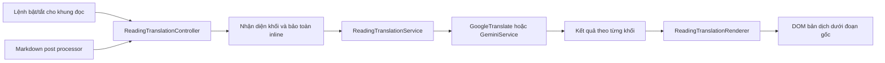

# Dịch song ngữ trong Reading Mode

Ngày: 2026-10-18

Snapshot khảo sát: `main@515e7b0`

Trạng thái: Người dùng đã duyệt ngày 2026-10-18; đã triển khai Native và kiểm thử cục bộ, đang chờ review toàn nhánh. Obsidian/provider thật: NOT_RUN.

## 1. Mục tiêu và quyết định đã xác nhận

Người dùng muốn trải nghiệm đọc song ngữ tương tự plugin [Obsidian Immersive Translate](https://github.com/imfenghuang/obsidian-immersive-translate), với phần dịch nổi bật hơn.

Các quyết định đã xác nhận trực tiếp:

1. Bản dịch chỉ hiển thị khi đọc trong Reading Mode.
2. Có thể bật/tắt bản dịch; không sửa file Markdown gốc.
3. Kiểu nhấn được chọn: **nền nổi rõ + chữ đậm hơn**.

Tiêu chí thành công: nhìn rõ đâu là bản dịch, đối chiếu được từng đoạn, đọc tài liệu dài trong theme sáng/tối, và nội dung ghi chú không thay đổi sau khi bật, tắt, hủy hoặc gặp lỗi dịch.

## 2. Cách tiếp cận

### Các phương án đã cân nhắc

| Phương án | Lợi ích | Đánh đổi |
| --- | --- | --- |
| Tự hiển thị bản dịch trong Reading Mode, dùng provider hiện có — chọn | Chủ động thiết kế, điều khiển vòng đời và kiểm tra việc không ghi file; dùng tiếp cấu hình Google/Gemini | Cần bổ sung bộ điều phối phiên đọc và bộ hiển thị theo khối |
| Nhúng SDK giống plugin tham chiếu | Có sẵn trải nghiệm của SDK | Thêm phụ thuộc SDK và cơ chế cấu hình ngoài project; mức tùy biến phụ thuộc SDK |

Chọn phương án thứ nhất. Tham khảo hành vi đọc song ngữ của plugin nguồn; triển khai bằng API Obsidian và provider hiện có. Mã nguồn plugin tham chiếu chủ yếu tải SDK Immersive Translate bên ngoài; nó không cung cấp bộ renderer song ngữ nội bộ có thể chuyển nguyên trạng vào project.

### Luồng người dùng

1. Mở ghi chú trong Reading Mode.
2. Chạy lệnh **Bật/tắt dịch song ngữ khi đọc** từ Command Palette. Một nút cùng hành vi được đặt trong thanh hành động của ghi chú, sử dụng icon ngôn ngữ của Obsidian.
3. Các đoạn đang hiển thị được ưu tiên dịch; khi cuộn đến nội dung tiếp theo, các đoạn mới tiếp tục được dịch.
4. Mỗi bản dịch xuất hiện ngay dưới đoạn gốc tương ứng. Không chờ hoàn tất toàn bộ tài liệu.
5. Bấm lại để tắt: xóa các phần hiển thị do tính năng này thêm vào và ngừng nhận kết quả của phiên cũ.

Tính năng mặc định tắt. Lệnh chỉ thực hiện trong Reading Mode, không tự chuyển chế độ cho người dùng. Nút có tên truy cập và trạng thái bật/tắt rõ ràng.

## 3. Thiết kế phần bản dịch

Giữ hình thức và nội dung đoạn gốc. Bản dịch là một khối đọc ngay dưới nó, không dùng popover và không yêu cầu hover.

| Thuộc tính | Thiết kế được chọn |
| --- | --- |
| Nền | Nền pha màu accent đủ rõ để tách với trang; điểm khởi đầu là 20% accent trên nền chính của theme |
| Viền | Viền dọc 4px theo accent của Obsidian |
| Chữ | Chữ chính của theme, độ đậm 600; giữ cỡ chữ đọc hiện tại; không in nghiêng toàn đoạn |
| Khoảng cách | Padding 12px; khoảng cách 8px từ đoạn gốc và 16px trước cặp đoạn tiếp theo |
| Hình dạng | Bo góc nhẹ 6px, không bóng đổ |
| Nội dung dài | Tự xuống dòng, không cắt chữ hoặc tạo thanh cuộn ngang cho văn bản thông thường |
| Trạng thái | Đang dịch, thành công và lỗi được phân biệt bằng nội dung trạng thái; không chỉ dựa vào màu |

Dùng token Obsidian để thích ứng theme sáng/tối. Nếu `color-mix` không được hỗ trợ, dùng nền phụ của theme cùng viền accent. Độ tương phản chữ thường cần đạt ít nhất 4.5:1 trong các theme được kiểm chứng; nếu nền pha không đạt, điều chỉnh nền thay vì giảm độ nổi bật bằng chữ mờ.

Tiêu đề vẫn giữ thứ bậc; bản dịch tiêu đề là văn bản bên dưới, không tạo thêm heading trong outline. Danh sách giữ vị trí thụt đầu dòng và ký hiệu của đoạn gốc; mỗi phương án trắc nghiệm được đối chiếu riêng. Không lặp nhãn “Bản dịch” trên mọi đoạn thành công.

## 4. Phạm vi nội dung

- Dịch heading, đoạn văn, nội dung văn bản của list item và lựa chọn trắc nghiệm.
- Không dịch hoặc sửa fenced code, inline code, khối công thức, công thức inline, bảng, HTML tương tác, nội dung nhúng, nút điều khiển hoặc phần do chính renderer dịch thêm vào.
- Với khối trộn văn bản và inline code/công thức, thay các phần cần bảo toàn bằng token trước khi gửi đi; khôi phục từ dữ liệu gốc khi hiển thị. Nếu provider làm hỏng hoặc mất token, hiển thị lỗi cho khối đó.
- Giữ nguyên DOM đoạn gốc, URL và đích liên kết. Bản dịch hiển thị nội dung văn bản và phần inline được khôi phục an toàn, không chèn HTML tùy ý từ provider.
- Một đoạn nằm trong list item chỉ được đưa vào hàng đợi một lần; không dịch cả cha và con cùng chứa đoạn đó.
- Các bản dịch đã được người dùng lưu sẵn trong Markdown là nội dung gốc của ghi chú; tính năng mới không xóa hoặc thay thế chúng. Không suy đoán mọi blockquote là bản dịch cũ.

## 5. Kiến trúc và trách nhiệm

| Thành phần | Trách nhiệm |
| --- | --- |
| `main.ts` | Khởi tạo controller, đăng ký post processor và lệnh; nối vòng đời plugin |
| `ReadingTranslationController` | Sở hữu phiên theo khung đọc và file; bật/tắt, ưu tiên đoạn trong/gần viewport, hủy nhận kết quả cũ |
| `readingBlockExtractor` | Chọn khối văn bản không trùng lặp; quản lý token inline code/công thức |
| `ReadingTranslationService` | Hàng đợi, gọi provider, trạng thái từng khối, cache, thử lại theo yêu cầu |
| `ReadingTranslationRenderer` | Tạo và gỡ bản dịch, placeholder, thông báo lỗi và nút thử lại; không phụ thuộc Vault |
| `src/types/index.ts` | Hợp đồng phiên đọc, khối dịch, kết quả và thiết lập engine |
| `src/ui/SettingsTab.ts` | Thiết lập engine của chế độ đọc; tái sử dụng nguồn, đích, endpoint và API key hiện có |
| `styles.css` | CSS giới hạn trong class riêng của bản dịch Reading Mode |

Dùng `registerMarkdownPostProcessor` và `MarkdownRenderChild`/`ctx.addChild` để nhận biết khi một section đọc bị gỡ hoặc render lại. Controller phải xử lý được cả section đã hiển thị trước lúc bật và section render thêm sau đó. Không mở rộng selector toàn bộ `document.body` để dịch giao diện Obsidian.

Không dùng trực tiếp pipeline `BilingualTranslationModal → reassembleBilingualMarkdown → vault.modify` của tính năng xuất file cho chế độ đọc này. Dùng service riêng có kết quả lỗi rõ ràng, tái sử dụng các provider cấp thấp; tránh kế thừa cơ chế coi văn bản gốc là bản dịch thành công khi provider lỗi.

## 6. Phiên đọc, provider và cache

### Phiên và vòng đời

- Mỗi khung Reading Mode có phiên riêng gắn với file đang hiển thị. Hai khung mở cùng file có thể bật/tắt độc lập.
- Đổi file, chuyển sang Edit Mode, đóng khung hoặc unload plugin sẽ kết thúc phiên đó. Quay lại Reading Mode bắt đầu ở trạng thái tắt.
- Một section render lại chỉ thay thế kết quả của section đó; không làm mất phần còn lại của phiên.
- Mỗi công việc mang session/generation ID, source path và dấu nhận diện nội dung/cấu hình. Chỉ cập nhật DOM nếu tất cả còn khớp và phần tử còn thuộc phiên đang bật.
- Tắt/hủy phải ngừng xếp thêm công việc và bỏ mọi phản hồi cũ, kể cả phản hồi của request cuối. `requestUrl` hiện không cung cấp cơ chế hủy HTTP đang bay qua lớp wrapper; thiết kế không tuyên bố đã hủy được request phía nhà cung cấp.

### Provider

- Thiết lập mới `readingTranslationEngine`: `google` hoặc `gemini`, mặc định `google`. Đây là lựa chọn riêng cho dịch khi đọc, không bị suy ra từ công tắc phân tích ngữ pháp.
- Google dùng `translateWithMeta` để tôn trọng ngôn ngữ nguồn/đích và endpoint hiện có.
- Gemini dùng khả năng batch hiện có, tối đa 8 khối mỗi batch; không gọi phân tích ngữ pháp cho mỗi đoạn.
- Prompt Gemini phải tôn trọng ngôn ngữ đích đang chọn, kể cả `zh`/`ja`; nếu cần, sửa helper tạo prompt đang mặc định mọi mã ngoài `en` thành tiếng Việt.
- Nếu chọn Gemini nhưng thiếu API key, hiển thị yêu cầu cấu hình; không tự đổi provider.
- Google chạy tối đa 2 request đồng thời; Gemini chạy 1 batch tại một thời điểm. Ưu tiên khối trong viewport và vùng đệm 300px để không gửi toàn bộ tài liệu dài ngay khi bật.
- Metadata AI lấy từ file của phiên đọc, không lấy nhầm file đang active ở khung khác. Chuẩn hóa theo `DocumentContextMeta.noteTitle`, `heading`, `tags`.

### Cache và lỗi

- Cache riêng trong RAM, LRU tối đa 200 kết quả thành công; không lưu ra Vault hoặc ổ đĩa.
- Cache phân biệt văn bản, nguồn, đích, engine, endpoint/model và ngữ cảnh có ảnh hưởng đến Gemini. Không dùng API key thô làm khóa hoặc ghi log.
- Thay đổi thiết lập liên quan sẽ tắt các phiên bị ảnh hưởng, dọn bản dịch đang hiển thị, vô hiệu hóa công việc cũ và xóa cache tương ứng. Không tự phát thêm request chỉ vì thay đổi thiết lập; người dùng bật lại để áp dụng.
- Provider lỗi, timeout hoặc batch thiếu mục sẽ đánh dấu lỗi cho từng khối tương ứng; không lặp nguyên văn bản gốc dưới nhãn bản dịch thành công.
- Nút **Thử lại** chỉ xếp lại khối lỗi đó khi phiên vẫn còn bật. Không retry vô hạn hoặc tự đổi provider.

## 7. Ranh giới phạm vi

- Bổ sung chế độ đọc tạm thời; tính năng xuất file song ngữ hiện có vẫn là một luồng riêng với tên lệnh phân biệt rõ.
- Không thêm lưu bản dịch ra file, dịch trong Live Preview/Edit Mode, đồng bộ cloud hoặc SDK Immersive Translate trong thay đổi này.
- Giữ nguyên tra từ bằng selection, popover, sidebar và lưu từ vựng. Không xử lý các lỗi audit không liên quan như một phần phụ của tính năng này.
- Không thực hiện gọi Gemini thật, dùng credential hoặc ghi vào Vault cá nhân trong quá trình triển khai nếu chưa được người dùng cho phép riêng.

## 8. Kiểm chứng và tiêu chí nghiệm thu

1. **Không ghi ghi chú:** bật, dịch xong, tắt, hủy và gặp lỗi đều không gọi `vault.modify`, `vault.process`, `vault.create` hoặc `editor.setValue` từ luồng đọc; nội dung/hash file giữ nguyên.
2. **Cặp đoạn:** heading, đoạn, danh sách lồng và trắc nghiệm có đúng một bản dịch ngay dưới khối tương ứng; không lặp đoạn cha/con.
3. **Bảo toàn nội dung kỹ thuật:** code/công thức/bảng/embed không bị dịch; inline token nguyên vẹn; liên kết gốc không đổi.
4. **Tắt/hủy:** phản hồi chậm của request cuối sau khi tắt không được thêm lại DOM hoặc báo thành công cho phiên đã kết thúc.
5. **Đổi file/cấu hình:** kết quả cũ không xuất hiện trong tài liệu mới hoặc dưới ngôn ngữ/engine mới.
6. **Nhiều khung:** bật/tắt ở một pane không ảnh hưởng pane khác; metadata đúng file của pane được dịch.
7. **Render lại:** section bị thay thế sẽ dọn listener, observer và kết quả cũ; không nhân đôi bản dịch.
8. **Lỗi thực sự:** timeout, provider trả `null`, lỗi HTTP và batch thiếu mục đều có trạng thái lỗi/Thử lại, không được tính là dịch thành công.
9. **Giới hạn hàng đợi/cache:** tuân thủ concurrency/batch, ưu tiên viewport, không request lại kết quả thành công có cùng khóa cache.
10. **Hình thức và truy cập:** kiểm tra theme sáng/tối, pane hẹp, tài liệu dài và zoom 200%; nền dịch nhìn rõ, chữ đậm 600, tương phản đạt yêu cầu; điều khiển dùng được bằng bàn phím.
11. **Hồi quy:** chạy lại bộ test hiện có và build. Ghi rõ lỗi TypeScript có sẵn tại baseline; kiểm tra phần mới với type API Obsidian thật, không dùng build thành công để thay thế typecheck.
12. **Chạy thật:** kiểm thử trong Obsidian bằng ghi chú thử nghiệm riêng là lớp bằng chứng riêng. Nếu không chạy được, báo `NOT_RUN`; test DOM/mock không được mô tả là đã nghiệm thu trong Obsidian.

Đặc tả này chưa phải bằng chứng tính năng đã được xây dựng hoặc các tiêu chí trên đã pass.

## 9. Nguồn tham khảo và hiện trạng

- [README plugin tham chiếu](https://github.com/imfenghuang/obsidian-immersive-translate#usage): Reading Mode, cấu hình selectors/excludeSelectors.
- [Mã khởi tạo plugin tham chiếu](https://github.com/imfenghuang/obsidian-immersive-translate/blob/main/src/main.ts): nạp SDK ngoài và dọn nội dung khi unload.
- [Obsidian: Markdown post processing](https://docs.obsidian.md/Plugins/Editor/Markdown+post+processing).
- [Obsidian: MarkdownPostProcessorContext.addChild](https://docs.obsidian.md/Reference/TypeScript+API/MarkdownPostProcessorContext/addChild).
- Hiện trạng local đã khảo sát: `main.ts`, `src/types/index.ts`, `src/services/provider/GoogleTranslate.ts`, `src/services/provider/GeminiService.ts`, `src/services/translation/BilingualTranslationService.ts`, `src/ui/BilingualTranslationModal.ts`, `src/utils/bilingualParser.ts`, `styles.css`.
