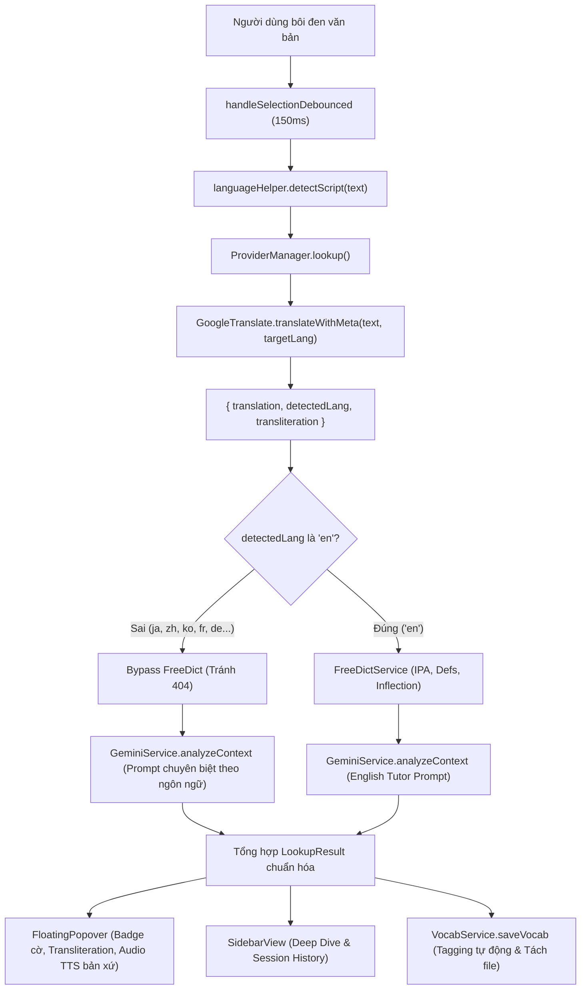

# Đặc Tả Thiết Kế Kỹ Thuật: Mở Rộng Hỗ Trợ Đa Ngôn Ngữ (Multilingual Study Expansion)

**Tài liệu:** `docs/superpowers/specs/2026-10-18-multilingual-study-expansion-design.md`  
**Dự án:** `obsidian-english-study`  
**Trạng thái:** Chờ duyệt (Pending Review)  
**Ngày lập:** 2026-10-18  

---

## 1. Tổng Quan & Bối Cảnh (Overview & Context)
Plugin `obsidian-english-study` ban đầu được thiết kế chuyên biệt cho việc học tiếng Anh với Free Dictionary API (`api.dictionaryapi.dev`). Tuy nhiên, nhu cầu học tập thực tế của người dùng Obsidian bao gồm việc đọc và tra cứu song song nhiều ngôn ngữ khác nhau: Tiếng Nhật (Japanese), Tiếng Trung (Chinese), Tiếng Hàn (Korean), Tiếng Pháp (French), Tiếng Đức (German), Tiếng Tây Ban Nha (Spanish), Tiếng Nga (Russian), v.v.

Mục tiêu của dự án là mở rộng toàn diện khả năng tra cứu, phiên âm, phát âm giọng bản xứ và lưu trữ từ vựng đa ngôn ngữ trong cùng một plugin, mà vẫn duy trì:
1. Tốc độ tra cứu tức thì ($0\text{ms}$ khi cache hit, $< 300\text{ms}$ qua mạng).
2. Tự động nhận diện ngôn ngữ nguồn (Auto-detection) mà không đòi hỏi thao tác thủ công phức tạp.
3. Phiên âm tự nhiên: Romaji/Furigana cho tiếng Nhật, Pinyin cho tiếng Trung, Romaja cho tiếng Hàn, IPA cho tiếng Anh/châu Âu.
4. Phát âm Web Speech TTS đúng giọng bản xứ tương ứng với từng ngôn ngữ.
5. Tổ chức sổ từ vựng khoa học trong Vault: tự động gắn tag ngôn ngữ (`#vocab/japanese`, `#vocab/chinese`...) và tùy chọn phân tách file (`Vocabulary_ja.md`).

---

## 2. Kiến Trúc Hệ Thống (System Architecture)



---

## 3. Thiết Kế Chi Tiết Từng Module (Detailed Design)

### 3.1. Module Tiện Ích Ngôn Ngữ: `src/utils/languageHelper.ts`
Chịu trách nhiệm chuẩn hóa thông tin ngôn ngữ trên toàn bộ hệ thống:

```typescript
export interface LanguageMeta {
  code: string;              // Mã ISO 639-1 (e.g. "ja", "zh", "ko", "en", "fr")
  nameVi: string;            // Tên tiếng Việt (e.g. "Tiếng Nhật")
  badge: string;             // Badge hiển thị UI (e.g. "🇯🇵 JA")
  speechLocale: string;      // SpeechSynthesis locale (e.g. "ja-JP", "zh-CN", "en-US")
  vocabTag: string;          // Tag từ vựng (e.g. "#vocab/japanese")
}

export const SUPPORTED_LANGUAGES: Record<string, LanguageMeta>;
export function getLanguageMeta(langCode?: string): LanguageMeta;
export function detectScript(text: string): "ja" | "zh" | "ko" | "ru" | "latin" | "other";
```

- **Quy tắc nhận diện Script (`detectScript`)**:
  - `ja`: Chứa ký tự Hiragana (`[\u3040-\u309F]`) hoặc Katakana (`[\u30A0-\u30FF]`).
  - `ko`: Chứa ký tự Hangul (`[\uAC00-\uD7AF\u1100-\u11FF]`).
  - `zh`: Chứa ký tự Hanzi (`[\u4E00-\u9FFF]`) và không chứa Kana.
  - `ru`: Chứa ký tự Cyrillic (`[\u0400-\u04FF]`).
  - `latin`: Các ký tự bảng chữ cái Latin (`[a-zA-ZÀ-ÿ]`).

---

### 3.2. Cấu Trúc Dữ Liệu: `src/types/index.ts`
Mở rộng các interface để hỗ trợ đa ngôn ngữ:

```typescript
export interface PluginSettings {
  // Nhóm 1: Tương tác đọc
  autoTranslateOnSelection: boolean;
  triggerMode: TriggerMode;

  // Mới: Nhóm Ngôn ngữ học tập
  sourceLanguage: string;               // Mặc định: "auto" (Tự động nhận diện)
  targetLanguage: string;               // Mặc định: "vi" (Dịch sang tiếng Việt)
  separateVocabFileByLanguage: boolean; // Mặc định: false (Tách file theo ngôn ngữ)

  // Nhóm 2: Sổ từ vựng
  vocabFilePath: string;
  vocabFormat: VocabFormat;
  useDailyNote: boolean;
  highlightWordInContext: boolean;

  // Nhóm 3: Dịch thuật & AI
  translateEndpointUrl: string;
  geminiApiKey: string;
  enableAiGrammar: boolean;

  // Nhóm 4: Phát âm
  preferredAccent: PreferredAccent;
  autoPlayAudio: boolean;
}

export interface LookupResult {
  query: string;
  type: LookupType;
  contextSentence: string;
  contextSentenceClean: string;
  phonetic?: string;
  audioUrl?: string;
  vietnameseTranslation: string;
  definitions?: DictDefinition[];
  aiGrammarNote?: string;
  timestamp: number;

  // Mới: Thuộc tính đa ngôn ngữ
  sourceLang?: string;         // e.g. "ja", "zh", "ko", "fr", "en"
  targetLang?: string;         // e.g. "vi"
  transliteration?: string;    // Pinyin, Romaji, Romaja, v.v.
}
```

---

### 3.3. Nâng Cấp Google Translate Engine: `src/services/provider/GoogleTranslate.ts`
Tận dụng tham số `dt=t&dt=rm` của Google Translate GTX API:

```typescript
export interface GoogleTranslationMeta {
  translation: string;
  detectedLang: string;
  transliteration?: string;
}

export class GoogleTranslate extends BaseProvider {
  async translateWithMeta(
    text: string,
    sourceLang: string = "auto",
    targetLang: string = "vi",
    customEndpointUrl?: string
  ): Promise<GoogleTranslationMeta | null>;
}
```
- Endpoint format:
  `{base}/translate_a/single?client=gtx&sl={sourceLang}&tl={targetLang}&dt=t&dt=rm&q={encodedText}`
- Bóc tách dữ liệu:
  - `data[0]` $\rightarrow$ Các chunk dịch nghĩa kết hợp thành `translation`.
  - `data[0][chunk.length - 1][3]` hoặc `data[0][0][3]` $\rightarrow$ `transliteration` (Romaji / Pinyin).
  - `data[2]` $\rightarrow$ `detectedLang` (mã ngôn ngữ phát hiện được, e.g. `"ja"`, `"zh-CN"`, `"ko"`).

---

### 3.4. Nâng Cấp Điều Phối Trung Tâm: `src/services/provider/ProviderManager.ts`
- **Bypass FreeDict khi không phải tiếng Anh**:
  - Dùng `detectScript(cleanText)` để kiểm tra nhanh. Nếu phát hiện ký tự CJK hoặc mã nguồn chọn trước không phải `"en"`, bỏ qua `FreeDictService` hoàn toàn để tránh request thừa và lỗi 404.
- **Tùy biến Prompt Gemini theo ngôn ngữ nguồn**:
  - Với tiếng Nhật (`ja`): Yêu cầu giải thích Kanji, cách đọc Furigana/Romaji và ngữ pháp.
  - Với tiếng Trung (`zh`): Yêu cầu phân tích Pinyin, từ loại và thành ngữ Hán Việt tương đương.
  - Với tiếng Hàn (`ko`): Yêu cầu giải thích kính ngữ, gốc từ và ngữ pháp.

---

### 3.5. Phát Âm Web Speech TTS Bản Xứ: `src/ui/FloatingPopover.ts` & `SidebarView.ts`
- Khi người dùng bấm nút Loa phát âm (hoặc `autoPlayAudio = true`):
  - Kiểm tra `result.sourceLang`.
  - Gọi `getLanguageMeta(result.sourceLang).speechLocale`.
  - Gán `utterance.lang = locale` (ví dụ `ja-JP` cho tiếng Nhật, `zh-CN` cho tiếng Trung).
  - Tìm kiếm trong `window.speechSynthesis.getVoices()` voice có locale khớp để phát âm với chất lượng tốt nhất.

---

### 3.6. Quản Lý Sổ Từ Vựng: `src/services/storage/VocabService.ts`
- **Tự động gắn Tag ngôn ngữ**:
  - Khi lưu dạng bảng Markdown hoặc Callout, tự động chèn tag ngôn ngữ chuẩn hóa (ví dụ: `#vocab/japanese`, `#vocab/chinese`).
- **Tách file theo ngôn ngữ (khi `separateVocabFileByLanguage = true`)**:
  - Đường dẫn gốc: `Vocabulary.md` $\rightarrow$ `Vocabulary_ja.md`, `Vocabulary_zh.md`.
  - Hỗ trợ cả file trong thư mục lồng: `Languages/Vocab.md` $\rightarrow$ `Languages/Vocab_ja.md`.
- **Cột phiên âm**: Lưu cả `result.phonetic` hoặc `result.transliteration` (Romaji / Pinyin) vào cột phiên âm của bảng Markdown.

---

### 3.7. Giao Diện Cài Đặt: `src/ui/SettingsTab.ts`
Bổ sung nhóm cài đặt chuyên biệt:
**`NGÔN NGỮ HỌC TẬP (MULTILINGUAL SETTINGS)`**:
1. Dropdown: **Ngôn ngữ nguồn (Học tập)**:
   - `auto`: "Tự động nhận diện (Tất cả ngôn ngữ - Khuyến nghị)"
   - `en`: "Tiếng Anh (English)"
   - `ja`: "Tiếng Nhật (Japanese)"
   - `zh`: "Tiếng Trung (Chinese)"
   - `ko`: "Tiếng Hàn (Korean)"
   - `fr`: "Tiếng Pháp (French)"
   - `de`: "Tiếng Đức (German)"
   - `es`: "Tiếng Tây Ban Nha (Spanish)"
   - `ru`: "Tiếng Nga (Russian)"
2. Dropdown: **Ngôn ngữ đích (Dịch nghĩa)**:
   - `vi`: "Tiếng Việt (Mặc định)"
   - `en`: "Tiếng Anh (English)"
   - `zh`: "Tiếng Trung (Chinese)"
   - `ja`: "Tiếng Nhật (Japanese)"
3. Toggle: **Tách riêng file từ vựng cho từng ngôn ngữ**:
   - Bật/Tắt chế độ tạo file `Vocabulary_<lang>.md`.

---

## 4. Kế Hoạch Kiểm Thử TDD (Verification & TDD Roadmap)

### Unit & Integration Test Suites Mới / Cập Nhật:
1. `tests/utils/languageHelper.test.ts`:
   - Kiểm tra `detectScript` nhận diện đúng Hiragana/Katakana (ja), Hangul (ko), Hanzi (zh), Cyrillic (ru), Latin.
   - Kiểm tra `getLanguageMeta` trả về đúng badge, locale TTS, và tag Dataview.
2. `tests/services/GoogleTranslate.test.ts`:
   - Kiểm tra bóc tách `translation`, `detectedLang`, và `transliteration` từ response `dt=rm`.
3. `tests/services/ProviderManager.test.ts`:
   - Kiểm tra điều hướng bypass FreeDict khi ngôn ngữ không phải là `"en"`.
   - Kiểm tra truyền đúng prompt ngữ cảnh cho Gemini theo từng ngôn ngữ.
4. `tests/services/VocabService.test.ts`:
   - Kiểm tra gắn tag `#vocab/<lang>` khi lưu vào bảng/callout.
   - Kiểm tra tách file `Vocabulary_<lang>.md` khi bật `separateVocabFileByLanguage`.
5. `tests/ui/floatingUi.test.ts`:
   - Kiểm tra hiển thị badge ngôn ngữ trên Popover header.
   - Kiểm tra Web Speech TTS sử dụng đúng locale `ja-JP`, `zh-CN`, v.v.

---

## 5. Rủi Ro & Giải Pháp Phòng Ngừa (Risks & Mitigations)
1. **Lỗi mạng khi gọi Gemini**:
   - Google Translate vẫn luôn cung cấp nghĩa dịch + phiên âm Pinyin/Romaji cơ bản ngay cả khi không có kết nối Gemini API.
2. **Hệ điều hành thiếu Voice TTS**:
   - Web Speech API có cơ chế fallback mềm: nếu không tìm thấy voice đúng vùng miền (dialect), trình duyệt sẽ sử dụng generic voice hoặc giữ nguyên âm đọc an toàn mà không gây crash ứng dụng.
3. **Hiệu năng bôi đen liên tục**:
   - Cơ chế Debounce 150ms kết hợp RAM LRU Cache 200 entries đảm bảo không bị giật lag và không spam request.
