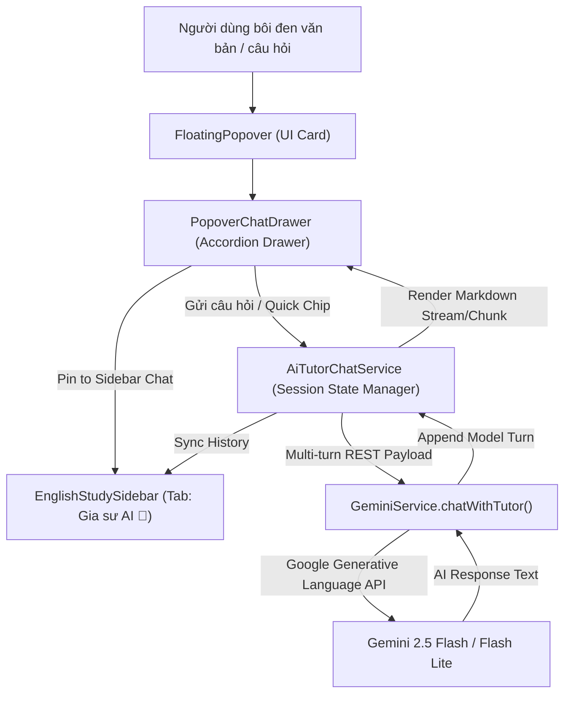

# Thiết Kế Kỹ Thuật: Khung Chat "Hỏi Sâu Gia Sư AI" (Mini Conversational AI Tutor)

**Trạng thái:** Sẵn sàng thực thi (Ready for Implementation)  
**Ngày lập:** 2026-10-19  
**Kiến trúc:** Hybrid Component Architecture (Popover Chat Drawer + Seamless Handoff to Sidebar View)  
**Tác giả:** Antigravity Master Orchestrator (Cùng chuyên gia `agency-software-architect`, `agency-backend-architect`, `agency-ui-designer`)

---

## 1. Mục Tiêu & Bối Cảnh Người Dùng (Goal & Context)

### 1.1 Vấn đề thực tế
Khi người dùng đang đọc tài liệu chuyên ngành hoặc giải đề thi trắc nghiệm (MCQ) trong Obsidian:
1. Bản dịch và ghi chú ngữ pháp ngắn của Popover đôi khi **chưa đủ thỏa mãn** thắc mắc sâu (ví dụ: *"Tại sao câu này chọn đáp án B mà không phải C?", "Bẫy ngữ pháp ở đây là gì?", "Từ này khác gì với từ đồng nghĩa X trong y khoa?"*).
2. Người dùng ngại phải copy ngữ cảnh, mở tab trình duyệt khác sang ChatGPT/Gemini rồi dán vào hỏi, làm **đứt gãy mạch đọc sâu (flow state)**.
3. Người dùng cần một gia sư AI túc trực ngay tại popover, hiểu rõ ngữ cảnh câu đang đọc, bài trắc nghiệm đang làm, và có thể chuyển tiếp mượt mà sang Sidebar nếu cuộc hội thoại kéo dài.

### 1.2 Giải pháp thiết kế
Xây dựng tính năng **Mini Conversational AI Tutor**:
- **Tại FloatingPopover:** Tích hợp `PopoverChatDrawer` ở phía dưới thẻ từ vựng với giao diện Accordion thu gọn/mở rộng, cung cấp các Prompt Chips nhanh định hướng trắc nghiệm/học thuật, ô nhập câu hỏi tự do, và nút chuyển phiên sang Sidebar.
- **Tại EnglishStudySidebar:** Bổ sung tab thứ 3 **"Gia sư AI 💬"** kế thừa trọn vẹn lịch sử hội thoại từ Popover, cho phép trao đổi học thuật đường dài mà không sợ bị tắt do click chuột ra ngoài.
- **Tại Backend Engine:** `AiTutorChatService` quản lý trạng thái phiên hội thoại (multi-turn) và `GeminiService.chatWithTutor()` gọi API REST đa lượt của Gemini (`contents: [{ role: "user" | "model", parts: [{ text }] }]`) kết hợp `systemInstruction` nạp toàn diện ngữ cảnh tài liệu (`docContext`, `targetText`, `contextSentence`).

---

## 2. Kiến Trúc Hệ Thống (Architecture & Component Boundaries)



---

## 3. Chi Tiết Các Thực Thể & Giao Diện (Data Model & Interfaces)

### 3.1 Cấu trúc Dữ liệu Phiên Chat (`src/types/index.ts`)

```typescript
export interface TutorChatMessage {
  id: string;
  role: "user" | "model";
  content: string;
  timestamp: number;
}

export interface TutorSession {
  id: string;
  query: string;
  contextSentence: string;
  sourceLang?: string;
  targetLang?: string;
  docContext?: DocumentContextMeta;
  messages: TutorChatMessage[];
  createdAt: number;
  updatedAt: number;
}

export interface QuickPromptChip {
  id: string;
  icon: string;
  label: string;
  promptTemplate: (query: string, contextSentence: string) => string;
}
```

### 3.2 Quick Prompt Chips Tiêu Chuẩn

1. **MCQ Analysis (Ưu tiên số 1):**
   - Icon: `help-circle`
   - Label: `Giải thích câu trắc nghiệm MCQ`
   - Prompt: `Hãy phân tích chi tiết câu hỏi trắc nghiệm sau: 1) Giải thích vì sao đáp án đúng là chính xác. 2) Chỉ ra các bẫy ngữ pháp/từ vựng và lý do vì sao các đáp án còn lại bị loại trừ.`
2. **Synonym & Nuance:**
   - Icon: `split`
   - Label: `Phân biệt từ đồng nghĩa & sắc thái`
   - Prompt: `Hãy phân biệt "${query}" với các từ/cụm từ đồng nghĩa phổ biến trong cùng lĩnh vực, chỉ ra sắc thái ngữ cảnh (formal/informal/technical) và cho ví dụ so sánh.`
3. **Deep Grammar:**
   - Icon: `code`
   - Label: `Phân tích cấu trúc ngữ pháp sâu`
   - Prompt: `Hãy bóc tách cấu trúc ngữ pháp chuyên sâu của câu "${contextSentence}", làm rõ các mệnh đề, liên từ, biến thể tương đương và lưu ý khi sử dụng.`
4. **Collocations & Examples:**
   - Icon: `pencil`
   - Label: `Collocations & 3 câu ví dụ thực tế`
   - Prompt: `Hãy liệt kê các collocations/cụm từ cố định thường gặp nhất với "${query}" và đặt 3 câu ví dụ thực tế trong đời sống/học thuật kèm dịch nghĩa.`

---

## 4. Đặc Tả Kỹ Thuật Dịch Vụ AI (`AiTutorChatService` & `GeminiService`)

### 4.1 System Instruction Prompt
Hệ thống tạo `systemInstruction` nhằm định hình nhân cách và năng lực của Gia sư AI:
```text
Bạn là "Polyglot AI Tutor" - một gia sư học thuật và chuyên gia khảo thí ngôn ngữ xuất sắc.
Nhiệm vụ của bạn là hỗ trợ người học phân tích sâu về từ vựng, ngữ pháp, bài đọc và đặc biệt là các câu hỏi trắc nghiệm (MCQ).

Ngữ cảnh hiện tại của bài đọc:
- Tiêu đề ghi chú/bài viết: "${docContext.noteTitle || 'Không xác định'}"
- Đề mục/Chương: "${docContext.heading || 'Không xác định'}"
- Thẻ lĩnh vực/Tags: "${docContext.tags.join(', ') || 'Chung'}"
- Đoạn văn/Câu ngữ cảnh: "${session.contextSentence}"
- Từ/Cụm từ trọng tâm: "${session.query}"

Quy tắc ứng xử & phản hồi:
1. Trả lời bằng ngôn ngữ đích (${targetLangName}), định dạng chuẩn Markdown (sử dụng in đậm, danh sách gạch đầu dòng, khối code hoặc bảng khi cần thiết).
2. Khi giải thích câu trắc nghiệm: luôn giải thích cặn kẽ tại sao đáp án đúng được chọn và vạch trần bẫy của các phương án sai.
3. Câu trả lời súc tích, đi thẳng vào trọng tâm học thuật, không rườm rà khách sáo.
```

### 4.2 Multi-Turn Request Format (`GeminiService.chatWithTutor`)
- **Endpoint:** `https://generativelanguage.googleapis.com/v1beta/models/{model}:generateContent?key={apiKey}`
- **Payload:**
```json
{
  "systemInstruction": {
    "parts": [{ "text": "..." }]
  },
  "contents": [
    { "role": "user", "parts": [{ "text": "..." }] },
    { "role": "model", "parts": [{ "text": "..." }] },
    { "role": "user", "parts": [{ "text": "..." }] }
  ],
  "generationConfig": {
    "temperature": 0.3,
    "topP": 0.85
  }
}
```
- **Fallback Cơ chế:** Nếu model mặc định `gemini-flash-latest` trả về HTTP 429 (Resource Exhausted), tự động kích hoạt cờ fallback và thử lại với `gemini-flash-lite-latest`.

---

## 5. Đặc Tả Giao Diện (`PopoverChatDrawer` & `EnglishStudySidebar`)

### 5.1 `PopoverChatDrawer.ts`
- **Accordion Toggle:**
  - Nút bấm tinh gọn ở chân Popover: `💬 Hỏi sâu Gia sư AI (Mở rộng ▼)` kèm icon `chevron-down` / `chevron-up`.
  - Mặc định ở trạng thái đóng (collapsed) để không làm phình popover ban đầu. Khi người dùng click, chuyển sang `expanded` với transition mượt mà.
- **Header thanh Drawer:**
  - Tiêu đề: `Gia sư AI Polyglot`.
  - Nút `Ghim sang Sidebar` (icon `panel-right` với tooltip "Mở rộng sang Sidebar để trao đổi dài hạn").
  - Nút `Xóa cuộc hội thoại` (icon `trash-2`).
- **Quick Action Chips Carousel:**
  - Hàng ngang trượt mềm mại (`overflow-x: auto`), chứa 4 chip định sẵn.
  - Khi click vào 1 chip: Tự động gửi prompt tương ứng vào luồng chat.
- **Message List Container:**
  - `max-height: 220px; overflow-y: auto`.
  - Hỗ trợ cuộn tự động (auto-scroll) đến tin nhắn mới nhất.
  - Render Markdown cho câu trả lời của AI thông qua `renderMarkdownToElement`.
- **Chat Input Bar:**
  - Textarea tự co giãn (auto-resize từ 34px đến 80px).
  - Phím tắt: `Enter` để gửi, `Shift + Enter` để xuống dòng.
  - Nút gửi (`send-btn` với icon `send`).
  - Trạng thái loading: Hiển thị hiệu ứng 3 chấm nhấp nháy hoặc spinner mượt mà ("Gia sư đang suy nghĩ...").

### 5.2 Tích Hợp Vào `FloatingPopover.ts`
- Thêm `chatDrawer: PopoverChatDrawer` vào cuối thẻ `FloatingPopover`.
- Khi Drawer mở rộng, popover tự động tính toán lại chiều cao hoặc điều chỉnh `max-height: min(85vh, vh - top - 16px)` để không bị tràn màn hình.
- Nút "Ghim sang Sidebar" sẽ kích hoạt callback `onPinToSidebarChat(session: TutorSession)`.

### 5.3 Tích Hợp Vào `SidebarView.ts`
- Bổ sung tab thứ 3 trên navigation: `[Chi tiết sâu] | [Lịch sử (N)] | [Gia sư AI 💬]`.
- Khi người dùng click "Pin to Sidebar" từ Popover, Sidebar mở ra, kích hoạt tab `Gia sư AI`, tải toàn bộ lịch sử hội thoại của từ đó và cuộn xuống cuối.
- Giao diện Sidebar Chat có khung hiển thị rộng rãi, hỗ trợ tiếp tục nhắn tin hỏi đáp không giới hạn lượt.

---

## 6. Chiến Lược Kiểm Thử (Testing & Quality Gate - Superpowers TDD)

Tuân thủ nghiêm ngặt quy trình TDD Red-Green-Refactor:
1. **Unit Tests Cho `AiTutorChatService` (`tests/services/AiTutorChatService.test.ts`):**
   - Khởi tạo session mới từ `LookupResult` & `docContext`.
   - Thêm user message và model message vào lịch sử.
   - Xây dựng prompt system instruction chính xác theo ngôn ngữ và chủ đề bài đọc.
   - Reset/clear session.
2. **Unit Tests Cho `GeminiService.chatWithTutor` (`tests/services/GeminiServiceTutor.test.ts`):**
   - Gửi payload chuẩn định dạng đa lượt (`contents: [{ role, parts }]`).
   - Xử lý phản hồi thành công và trích xuất nội dung văn bản.
   - Xử lý lỗi kết nối, API key trống, hoặc quota 429 fallback sang flash-lite.
3. **Unit Tests Cho `PopoverChatDrawer` (`tests/ui/PopoverChatDrawer.test.ts`):**
   - Khởi tạo DOM, toggle accordion đóng/mở.
   - Click Quick Chips kích hoạt sự kiện gửi prompt.
   - Nhập text và bấm Enter kích hoạt gửi tin nhắn.
   - Phát sự kiện `onPinToSidebar`.
4. **Integration Tests Cho `FloatingPopover` & `SidebarView` (`tests/ui/TutorChatIntegration.test.ts`):**
   - Đảm bảo Drawer được nhúng đúng vị trí trong Popover.
   - Chuyển giao dữ liệu phiên trơn tru sang Sidebar tab 3.
   - Đảm bảo toàn bộ 34 test suites hiện tại vẫn tiếp tục pass 100%.

---

## 7. Kế Hoạch Triển Khai (Next Steps)
Sau khi tài liệu thiết kế này được phê duyệt, sẽ tiến hành tạo Bản Kế Hoạch Thi Công TDD chi tiết (`docs/superpowers/plans/2026-10-19-mini-conversational-ai-tutor.md`) và thực hiện bằng phương pháp TDD.
